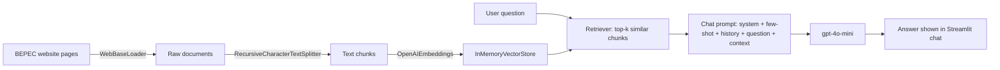

# BEPEC RAG Chatbot

A Retrieval-Augmented Generation (RAG) chatbot that answers questions about BEPEC Solutions (courses, placements, fees, careers) by grounding OpenAI's `gpt-4o-mini` model in live content scraped from the BEPEC website. Built with [LangChain](https://python.langchain.com/) and [Streamlit](https://streamlit.io/).

## How it works

1. **Scrape & index** — On first load, the app downloads a fixed list of BEPEC web pages, splits them into overlapping text chunks, embeds them with OpenAI embeddings, and stores the vectors in an in-memory vector store.
2. **Retrieve** — When a user asks a question, the chatbot embeds the question and retrieves the most similar chunks from the vector store (top-k, default `k=4`).
3. **Augment & generate** — The retrieved chunks are inserted into a prompt template (along with a couple of few-shot examples and the running chat history) and sent to `gpt-4o-mini`, which produces a grounded answer.
4. **Remember** — Chat history is kept in memory for the session so the model can hold a multi-turn conversation.



## Project structure

| File | Purpose |
|---|---|
| [backend.py](backend.py) | All the LangChain/RAG logic: scraping, chunking, embedding, retriever construction, prompt templates, and the conversational chain. Has no UI code — safe to reuse from any front end or script. |
| [frontend.py](frontend.py) | Streamlit UI. Renders the chat window, sidebar controls, and wires user input to `backend.py`. |
| [main.py](main.py) | Placeholder entry point (currently just prints a hello message). Not used by the Streamlit app. |
| requirements.txt | Python dependencies installed via `pip`. |
| pyproject.toml | Project metadata (name, version, minimum Python version). |

## `backend.py` walkthrough

- **`demo_chatbot()`** — Reads `OPENAI_API_KEY` from the environment (via a `.env` file) and returns a configured `ChatOpenAI` instance (`gpt-4o-mini`, temperature `0.3`, max 1024 tokens). Raises a clear error if the key is missing.
- **`BEPEC_URLS`** — The hard-coded list of BEPEC pages that get scraped and indexed.
- **`build_retriever(urls, k)`** — Loads the given URLs with `WebBaseLoader`, splits the text into ~1000-character chunks (150-character overlap) with `RecursiveCharacterTextSplitter`, embeds them using OpenAI's `text-embedding-3-small` model, and stores them in an `InMemoryVectorStore`. Returns a retriever configured to fetch the top `k` matching chunks (default 4).
- **`format_docs(docs)`** — Joins retrieved document chunks into a single string to inject into the prompt as `{context}`.
- **`examples` / `few_shot_prompt`** — A couple of example Q&A pairs used to steer the model's tone (friendly, BEPEC-branded) before it sees the real conversation.
- **`CHAT_PROMPT`** — The full prompt template: a system message (persona + instructions + injected `{context}`), the few-shot examples, a placeholder for prior chat turns (`history`), and the current user message (`input`).
- **`demo_memory()`** — Returns a fresh `InMemoryChatMessageHistory`, used to store the conversation for a session.
- **`demo_conversation(input_text, memory, retriever)`** — The main entry point called by the UI:
  1. Builds a chain that first retrieves context for the user's question (`RunnablePassthrough.assign`), then runs it through `CHAT_PROMPT` and the LLM.
  2. Wraps that chain in `RunnableWithMessageHistory` so chat history is automatically read from and appended to `memory`.
  3. Invokes the chain with the user's input and a fixed `session_id`, catching exceptions so the UI always gets a usable string back instead of crashing.
  4. Returns `(chat_reply, memory)` — the assistant's reply text and the (mutated) memory object.

## `frontend.py` walkthrough

- Sets up the Streamlit page (title, icon, layout) and a caption.
- **`get_retriever()`** — Wrapped in `@st.cache_resource` so the website is scraped and indexed only **once per server session**, not on every rerun or every user message. This is the expensive step (network fetch + embeddings).
- **Sidebar controls**:
  - *Clear Conversation* — resets `st.session_state.memory` and `chat_history`, then reruns the app for a blank chat.
  - *Re-index website* — clears the cached retriever (`get_retriever.clear()`) and reruns, forcing a fresh scrape/embedding pass (useful if the BEPEC site content changed).
- **Session state** — `st.session_state.memory` (LangChain chat history) and `st.session_state.chat_history` (list of `{role, text}` dicts for rendering) are initialized on first run and persisted across reruns.
- **Chat loop**:
  1. Replays prior messages from `chat_history` using `st.chat_message`.
  2. Reads new input via `st.chat_input`.
  3. Appends the user message to the transcript and displays it immediately.
  4. Calls `demo.demo_conversation(...)` inside a spinner, passing the current memory and retriever.
  5. Displays the assistant's reply and appends it to `chat_history`, and saves the updated memory back to session state.

## Prerequisites

- Python `>= 3.11` (see pyproject.toml)
- An OpenAI API key with access to `gpt-4o-mini` and `text-embedding-3-small`

## Setup

1. Install dependencies:
   ```powershell
   pip install -r requirements.txt
   ```
2. Create a `.env` file in the project root with your API key:
   ```
   OPENAI_API_KEY=your_key_here
   ```
3. Run the Streamlit app:
   ```powershell
   streamlit run frontend.py
   ```
4. Open the URL Streamlit prints (usually `http://localhost:8501`) and start chatting.

## Notes & known limitations

- The vector store is **in-memory**: all indexed content is lost when the Streamlit server restarts, and it is rebuilt from the live website (not cached to disk).
- The list of scraped URLs (`BEPEC_URLS` in [backend.py](backend.py)) is hard-coded; add or remove pages there to change what the bot knows about.
- Chat memory is per server process (via `st.session_state`), not persisted to a database — it resets when the browser session or server restarts.
- `requirements.txt` does not pin exact versions; consider pinning versions for reproducible installs.
- `.env` (and any file containing `OPENAI_API_KEY`) should **never** be committed to version control.
