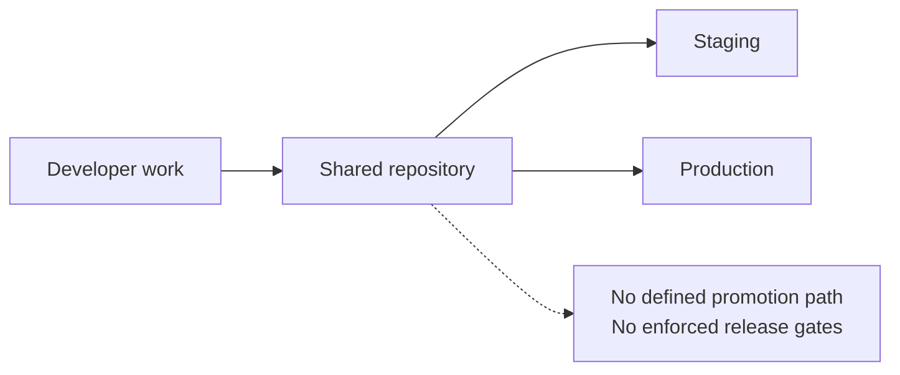
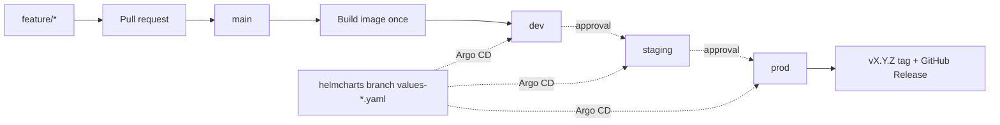
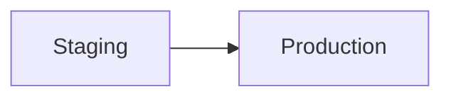
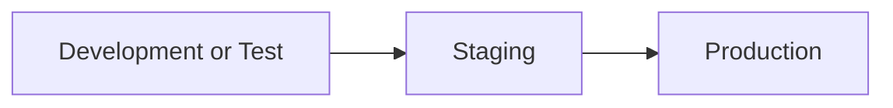
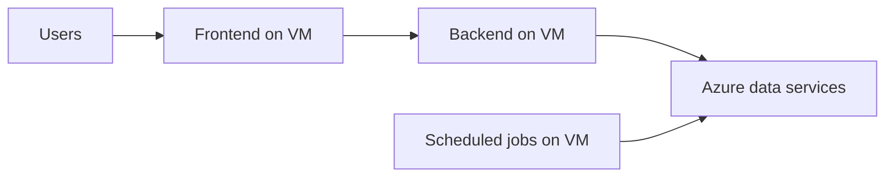
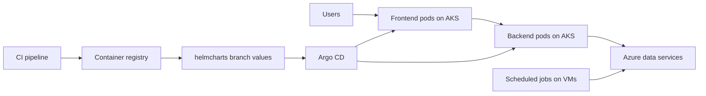
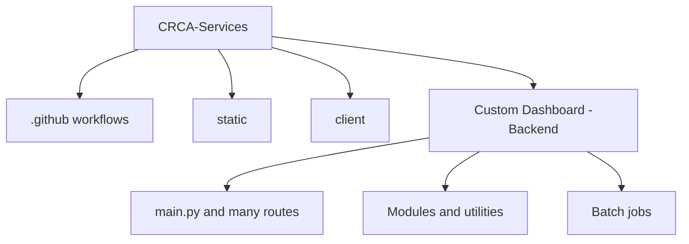
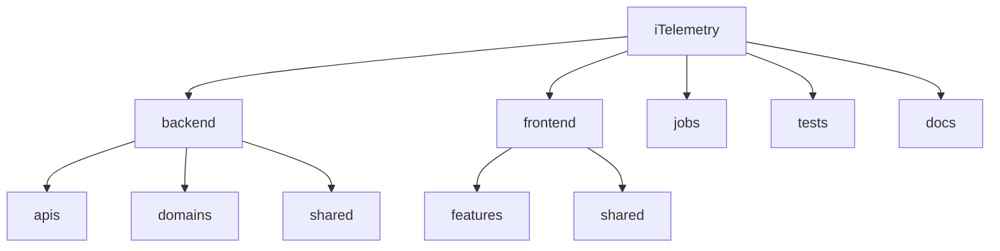
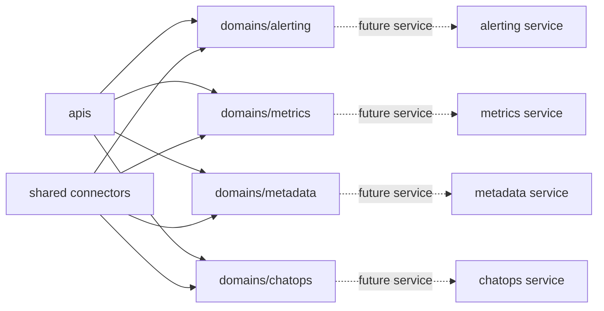

# iTelemetry Repo Before vs After

This document compares the legacy CRCA-Services layout with the iTelemetry target layout across four areas:

1. Branching strategy
2. Environments
3. Hosting model: IaaS to AKS
4. Folder architecture and microservice readiness

The "before" state below reflects the legacy baseline requested for this comparison: limited environment separation, VM-oriented deployment, and no consistently enforced branching model.

## Executive comparison

| Area | Before: CRCA-Services baseline | After: iTelemetry target | Why the after state is better |
| ---- | ------------------------------ | --------------------------- | ----------------------------- |
| Branching strategy | No clearly enforced promotion model; branch usage is effectively ad hoc in the legacy baseline | Trunk-based: short-lived `feature/*` -> `main`; one image built once and promoted dev -> staging -> prod by an approval-gated pipeline; GitOps `helmcharts` branch; automatic `vX.Y.Z` release tags | Safer promotions, traceable releases, cleaner rollback, and less environment drift |
| Environments | `production` and `staging` only | `development/test`, `staging`, and `production` | Earlier validation, lower release risk, better isolation for experiments and integration work |
| Hosting model | IaaS-first deployment on VMs | Frontend and backend on AKS, jobs retained on VMs where scheduling fits best | Containerized rollout, self-healing pods, horizontal scaling, GitOps deployment, and clearer runtime boundaries |
| Repository structure | Mixed legacy layout with a large backend surface, broad shared modules, and less explicit boundaries | Clear top-level split: `backend/`, `frontend/`, `jobs/`, `tests/`, `docs/` | Easier navigation, ownership, testing, and future decomposition |
| Backend architecture | Large route-heavy backend with logic and integration concerns spread broadly | `apis/` for HTTP, `domains/` for business logic, `shared/` for connectors | Lower coupling, cleaner change impact, and better microservice seams |
| Microservice readiness | Harder to extract services because responsibilities are less isolated | Domain boundaries allow `alerting`, `metrics`, `metadata`, or `chatops` to split with limited refactoring | Independent deployability becomes a planned extraction instead of a rewrite |

## 1. Branching strategy

### Comparison table

| Before | After |
| ------ | ----- |
| No stable branch promotion model in the requested legacy baseline | Trunk-based: every change goes through a pull request into `main` |
| Higher risk of direct or inconsistent releases | One pipeline: build once, then dev -> staging (approval) -> prod (approval) |
| Weak release traceability | The same image tag runs in every environment; prod releases get a `vX.Y.Z` git tag and GitHub Release |
| Manual coordination heavy | Pipeline writes the image tag to `helmcharts/values-*.yaml`; Argo CD deploys it |

Full details: [branching-strategy.md](branching-strategy.md).

### Before diagram



### After diagram: trunk-based with approval-gated pipeline



### Advantages of the after state

| Advantage | Impact |
| --------- | ------ |
| Controlled promotion path | Production receives only commits already validated earlier in the chain |
| Better rollback | Releases map to known commits and image versions |
| Lower drift | `values-*.yaml` on the `helmcharts` branch defines what is deployed where |
| Better auditability | Teams can answer what changed, when, and why with less manual reconstruction |

## 2. Environments

### Comparison table

| Before | After |
| ------ | ----- |
| `production` and `staging` | `development/test`, `staging`, and `production` |
| Less room for safe experimentation | A lower-risk environment for active validation |
| Staging can become overloaded with both QA and early integration work | Cleaner separation between integration testing and pre-production verification |

### Before diagram



### After diagram



### Advantages of the after state

| Advantage | Impact |
| --------- | ------ |
| Safer validation | Teams can test features and integration behavior before staging |
| Cleaner staging purpose | Staging becomes a real pre-production checkpoint instead of a catch-all environment |
| Faster debugging | Failures can be isolated earlier without blocking production promotion |
| Better change confidence | More issues are found before the final release gate |

## 3. Hosting model: IaaS before, AKS after

### Comparison table

| Before | After |
| ------ | ----- |
| VM-oriented IaaS deployment | AKS for frontend and backend, VMs retained for scheduled jobs |
| Runtime scaling tends to be host-based and manual | Pod-based scaling and rolling updates |
| Deployment logic is more server-centric | Deployment logic becomes image-centric and declarative |
| Recovery depends more on VM/process handling | Kubernetes handles restarts, desired state, and replica management |

### Before diagram: IaaS oriented deployment



### After diagram: AKS oriented deployment



### Advantages of AKS

| Advantage | Why it matters |
| --------- | -------------- |
| Self-healing | Failed pods are replaced automatically instead of depending on manual VM intervention |
| Horizontal scale | Frontend and backend can scale by replicas instead of duplicating full servers |
| Rolling deployments | New versions can be introduced with lower downtime risk |
| Immutable delivery | Deployments are based on versioned container images rather than mutable servers |
| GitOps compatibility | Argo CD can continuously reconcile the cluster to the declared desired state |
| Cleaner future service split | Each extracted service can follow the same container, chart, and deployment model |

## 4. Folder architecture

### Comparison table

| Before: CRCA-Services | After: iTelemetry | Why the after state is better |
| --------------------- | -------------------- | ----------------------------- |
| Large mixed repository with legacy CRA client, backend, static assets, pipelines, and docs intertwined | Clear top-level separation into `backend`, `frontend`, `jobs`, `tests`, and `docs` | Faster onboarding and less cognitive load when locating code |
| Backend responsibilities spread broadly across routes, modules, utilities, and batch scripts | Backend responsibilities split into `apis`, `domains`, and `shared` | Easier to reason about dependencies and change boundaries |
| Feature code and integration code are more tightly coupled | Business logic grouped by domain and connector logic centralized | Better testability and easier refactoring |

### Before diagram: legacy repo shape



### Before folder structure depiction

```text
CRCA-Services/
|-- .github/
|   `-- workflows/
|-- static/
|-- CRCA Custom Monitoring Dashboard/
|   |-- client/
|   |   `-- src/
|   |   |-- Components/
|   |   |   |-- Pages/
|   |   |   `-- utils/
|   |   `-- public/
|   `-- Custom Dashboard -Backend/
|       |-- main.py
|       |-- Modules/
|       |-- Batch Jobs/
|       |-- AlertRules/
|       `-- static/
|-- Branching_Strategy.md
`-- FOLDER_STRUCTURE.txt
```

### After diagram: iTelemetry repo shape



### After folder structure depiction

```text
<repo root>/
|-- .github/workflows/deploy.yaml
|-- backend/
|   |-- main.py
|   |-- apis/
|   |-- domains/
|   |   |-- alerting/
|   |   |-- metrics/
|   |   |-- metadata/
|   |   `-- chatops/
|   |-- shared/
|   `-- static/
|-- frontend/
|   |-- src/
|   |   `-- Components/
|   |       |-- features/
|   |       `-- shared/
|-- jobs/
|-- tests/
`-- docs/
```

### Why the iTelemetry structure is easier to split into microservices



### Advantages of the after folder structure

| Advantage | Impact |
| --------- | ------ |
| Clear separation of concerns | HTTP routing, business logic, and connector code change independently |
| Better domain ownership | Teams can work by business capability instead of by file sprawl |
| Easier testing | Unit and integration tests can target stable domain boundaries |
| Easier extractions | A domain can move behind its own API without redesigning the whole codebase |
| Better scaling model | High-load domains such as metrics or chatops can eventually scale independently |

## Summary

The legacy CRCA-Services baseline is best described as VM-oriented, environment-limited, and structurally harder to evolve. The iTelemetry target state improves that by introducing trunk-based development with an approval-gated build-once pipeline and automatic release tags, a `development/test` stage before staging and production, AKS-based runtime for the frontend and backend, and a domain-oriented folder structure that is deliberately aligned for future microservice extraction.